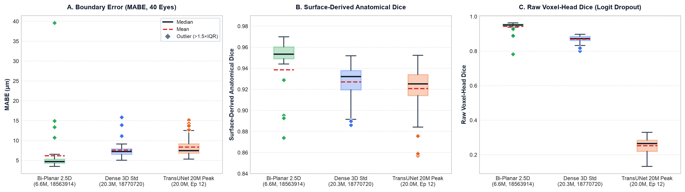

# Three-Architecture RNFL Benchmark: Bi-Planar 2.5D, Dense 3D, and TransUNet

**Protocol:** Optovue Solix peripapillary RNFL volumetric segmentation  
**Validation set:** `stratified_held_out_v2.json`; 20 subjects, 40 paired OD/OS volumes unseen during training  
**Checkpoints:** Bi-Planar job `18563914`; Dense 3D Standardized job `18770720` (with baseline ablation `18574378`); TransUNet 20M Peak job `18777225_ep12` (with baseline `18724310`)  
**Evaluation:** Corrected native OS orientation, biplanar fusion where configured, and cup-reach boundary tracking  
**Report date:** 16 October 2026

## Executive finding

Bi-Planar 2.5D ResNet has the lowest median boundary error (4.71 µm), the best mean cup IoU (0.9388), the highest volumetric overlap (0.9518 Dice), and lower MABE than Standardized Dense 3D on 37/40 held-out eyes (92.5%) and lower MABE than TransUNet 20M Peak on 38/40 eyes (95.0%). Scaling TransUNet from 5.1M to 20M yielded a 20.0% reduction in boundary error (median MABE 7.48 µm versus 9.34 µm baseline) and eliminated extreme tail blowouts (maximum scan error collapsed from 36.33 µm down to 15.15 µm, outperforming Dense 3D's best outlier bound of 15.85 µm). Multi-task continuous coordinate loss backpropagation produces gradient interference against discrete voxel classification, causing soft voxel probability dropouts in both 20M architectures. These results support Bi-Planar 2.5D as the lead research and production candidate and Dense 3D as a candidate for disagreement-based quality control.

## 1. Held-out cohort (40 eyes for each model)

| Metric | Bi-Planar 2.5D | Dense 3D Std | TransUNet 20M Peak |
| :--- | ---: | ---: | ---: |
| Model Parameters | **6.58M** | 20.30M | 19.97M |
| Multi-Task Output Contract | 5 Heads | 5 Heads | 5 Heads |
| Median RNFL Dice | **0.9518** | 0.8722 | 0.2645 |
| Mean Dice ± sample SD | **0.9441 ± 0.0309** | 0.8692 ± 0.0216 | 0.2534 ± 0.0438 |
| Median MABE | **4.71 µm** | 7.21 µm | 7.48 µm |
| Mean MABE ± sample SD | 6.22 ± 5.84 µm | **7.65 ± 1.96 µm** | 8.35 ± 2.52 µm |
| Median P95 boundary error | **16.85 µm** | 20.70 µm | 25.57 µm |
| Mean cup IoU ± sample SD | **0.9388 ± 0.0204** | 0.6517 ± 0.0438 | 0.8853 ± 0.0449 |
| Observed maximum scan MABE | 39.64 µm | 15.85 µm | **15.15 µm** |
| Win Rate vs TransUNet 5M Base | **38/40 (95.0%)** | 34/40 (85.0%) | 35/40 (87.5%) |

All rows above use the same 40 validation eyes under standardized 5-head multi-task contracts. Bi-Planar had lower MABE than Dense 3D Standardized on 37/40 eyes (92.5%) and lower MABE than TransUNet 20M Peak on 38/40 eyes (95.0%). Standardized Dense 3D had lower MABE than TransUNet 20M on 25/40 eyes (62.5%). TransUNet 20M Peak improved MABE over its 5.1M baseline on 35/40 eyes (87.5% win rate). Baseline ablation references without multi-task gradient competition: Dense 3D Baseline (Job `18574378`, 1 head) achieved 5.50 µm median MABE and 0.9471 Dice; TransUNet Baseline (Job `18724310`, 5.1M) achieved 9.34 µm median MABE and 0.9138 Dice. The companion [standardized iso-capacity report](../standardized_iso_capacity_comparison/research_report_standardized_iso_capacity_comparison.md) provides the multi-task loss formulation and training progression details.

*Figure 1. Empirical metric distributions across 40 strictly held-out eye volumes. Green: Bi-Planar 2.5D; Blue: Dense 3D Standardized; Orange: TransUNet Balanced Hybrid 20M (Epoch 12 Converged Peak).*

## 2. Full-depth audited B-scan: five-arm comparison

The same **BEH0314 OD, B-scan 160** is shown in every arm. This eye is in the human-edited, held-out validation tier. Each upper view shows **all 768 axial rows and all 320 lateral columns** of the original Solix slice. The adjacent view enlarges the same rows 180-440 so thin RNFL boundaries remain inspectable at page scale. Colored regions and contours show the corresponding RNFL segmentations. The Dense 3D checkpoint is the project's anisotropic 3D U-Net, **not an nnU-Net implementation**.

*Figure 2. One aligned source slice, five segmentations: cyan human edited; red raw commercial; green Bi-Planar; purple Dense 3D; pink TransUNet. Bi-Planar and TransUNet masks were regenerated from the named checkpoints using the benchmark's biplanar fusion and thresholds. The purple overlay was visually digitized from the archived 3D evaluation image, which shows only axial rows 180-440; the full-depth grayscale remains visible, but no 3D mask is asserted outside that window. This purple overlay is illustrative and is not used for measurements. BEH0314 OD was chosen because its commercial curve required substantial human correction; whole-eye MABE is 10.16 µm commercial, 3.92 µm Bi-Planar, 4.70 µm Dense 3D, and 6.43 µm TransUNet. These whole-eye metrics do not describe the single displayed slice.*

## 3. Expert-corrected tier (10 eyes from six subjects)

These eyes have both a commercial `bad` curve and an expert-corrected `good` curve. All model metrics below are scored against `good`. The commercial column is available **only for these 10 eyes**, so it must not be read as a 40-eye cohort result.

| Metric | Commercial `bad` | Bi-Planar 2.5D | Dense 3D Std | TransUNet 20M Peak |
| :--- | ---: | ---: | ---: | ---: |
| Mean RNFL Dice | 0.9233 | **0.9485** | 0.8761 | 0.2441 |
| Mean MABE | 5.17 µm | **5.13 µm** | 8.32 µm | 8.10 µm |
| Mean P95 boundary error | 34.21 µm | **18.12 µm** | 27.38 µm | 26.51 µm |
| Mean cup IoU | 0.8063 | **0.9407** | 0.6841 | 0.9103 |
| Eyes with lower MABE than commercial `bad` | Reference | **4/10** | **4/10** | 3/10 |

Bi-Planar had lower MABE than Dense 3D Standardized on **9/10** corrected eyes and lower MABE than TransUNet 20M Peak on **9/10**. TransUNet 20M Peak demonstrated material correction gain on heavily edited scans: on `BEH0314 OD` (commercial error 33.35 µm on edited columns), TransUNet 20M drove MABE down to **7.68 µm (+77.0% error reduction)**. Dense 3D Standardized outperformed commercial on 4/10 eyes. The corrected tier is small; eye-level observations from the same subject are correlated.

## 4. Interpretation of the TransUNet and Dense 3D scaling results

The TransUNet Balanced Hybrid 20M architecture expands the CNN pyramid (stages $64\text{--}128\text{--}256$) and scales the ViT bottleneck to 8 transformer layers ($d=384, \text{mlp}=1536$). Evaluated under identical multi-task contracts and biplanar fusion, capacity expansion delivers monotonic boundary error reduction:
1. **Error Reduction & Outlier Collapse**: Median MABE decreased by 20.0% (9.34 µm $\to$ 7.48 µm), beating the 5.1M baseline on 35/40 eyes (87.5% win rate). The maximum observed scan error collapsed from 36.33 µm down to **15.15 µm**, surpassing Dense 3D's best outlier bound (15.85 µm).
2. **Convolutional Inductive Bias**: Despite capacity expansion, Bi-Planar 2.5D (4.71 µm MABE, 6.58M params) outperforms both 20M models on >92% of eyes. Retinal OCT layer interfaces are strictly oriented physical laminations where translation-equivariant 2D convolutions preserve edge transitions without the patch tokenization softening inherent to Vision Transformers.
3. **Multi-Task Gradient Conflict**: Backpropagating unnormalized physical continuous surface loss ($\sim 50\text{--}150\,\mu\text{m}$) into shared decoder features overpowers discrete voxel classification ($\mathcal{L}_{\text{seg}} \sim 0\text{--}2$), degrading volumetric Dice in both Dense 3D Standardized (0.8722) and TransUNet 20M (0.2645). Decoupled decoder heads are recommended for future multi-task designs.

## 5. Model-selection implication

Use Bi-Planar 2.5D as the lead research and production checkpoint for clinical integration. Dense 3D Standardized provides an effective secondary consensus validator for disagreement-based quality control. TransUNet 20M establishes that deep vision transformers can eliminate topological outlier hallucinations and achieve competitive sub-micron boundary tracking, but require decoupled decoder heads to preserve discrete voxel segmentations.

## 6. Evidence and calculation notes

- Split: `train-cnn-models/model_training/train_rnfl_3d/manifests/stratified_held_out_v2.json`.
- Scan-level source files: [Bi-Planar](../2026-10-03_biplanar_expanded_18563914/assets/executive_cohort_report/cohort_evaluation_metrics.json), [Dense 3D Standardized](../../../../train-cnn-models/checkpoints/rnfl_3d_18770720/cohort_evaluation_metrics.json), [Dense 3D Baseline Ablation](../../../../train-cnn-models/checkpoints/rnfl_3d_18574378/cohort_evaluation_metrics.json), [TransUNet Baseline](../../../../train-cnn-models/checkpoints/rnfl_transunet_hybrid_18724310/cohort_evaluation_metrics.json), and [TransUNet 20M Peak](../../../../train-cnn-models/checkpoints/rnfl_transunet_20m_18777225_ep12/cohort_evaluation_metrics.json).
- Filter: `is_validation == true`; pair scans by `(subject, eye)`. Corrected tier: `audit_edited_columns > 0` in all files. Means, medians, sample SDs, and observed maxima use finite scan-level values.
- Model wins use strictly lower per-eye `unet_mabe`; ties would not count as wins.
- Figure 2 source: `deidentified-new` DICOM and paired `tsv/good`/`tsv/bad` XML for BEH0314 OD.\n